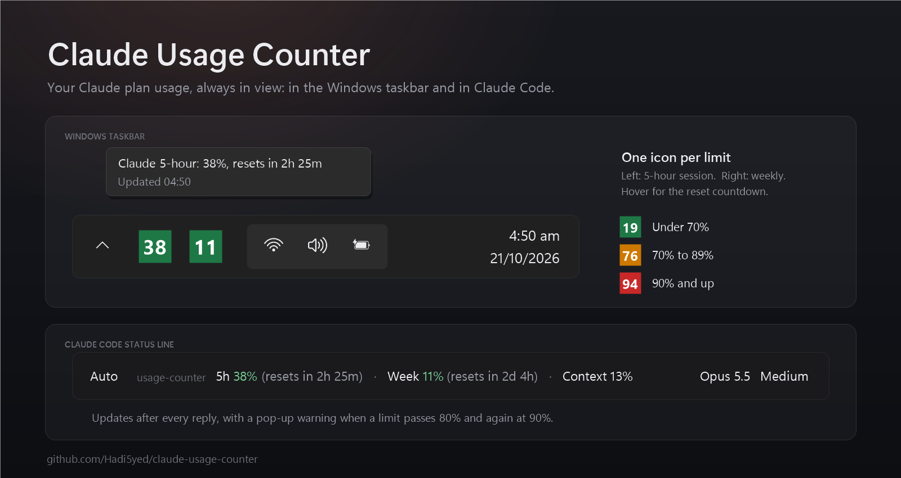

# Claude Usage Counter



A Claude Code mod that keeps your plan usage on screen, in the terminal and in the Claude desktop app's Code tab:

```
5h 23% (resets in 2h 10m)  ·  Week 41% (resets in 3d 4h)  ·  Context 34%
```

- **5h** and **Week**: your 5-hour session and weekly limits, with countdowns to their resets (refreshed every minute)
- **Context**: how full the current conversation's context window is
- A toast when either limit passes 80% and again at 90%

The figures come from the rate-limit data Claude's own replies carry, so they appear after the first reply of a session. Off a Claude subscription (API key billing) there are no rate-limit windows to show.

Inspired by [Claude Counter](https://github.com/she-llac/claude-counter), the browser extension that does the same for claude.ai.

## Install

At the prompt of a Claude Code terminal session:

```
/plugin install usage-counter --marketplace Hadi5yed/claude-usage-counter
```

Answer `y` to add the marketplace, then pick a scope (user scope loads it in every session).

From a shell:

```bash
claude plugin install usage-counter --marketplace Hadi5yed/claude-usage-counter
```

In the Claude desktop app, where `/plugin` does not run: click **+** next to the prompt box, then **Plugins**, **Add marketplace** with `Hadi5yed/claude-usage-counter`, then **Add plugin**.

## Taskbar icons (Windows)

`tray/` holds a small companion app that shows the same figures in the Windows notification area, the way HWiNFO shows sensor readings: one icon for the 5-hour limit and one for the weekly limit, each a number that turns orange at 70% and red at 90%. Hover an icon for the reset countdown; right-click for Refresh and Exit.

The mod saves its latest figures to `%USERPROFILE%\.claude\usage-counter\usage.json` and the app reads that file every 15 seconds, so it updates whenever a Claude Code session gets a reply. Usage on claude.ai counts against the same limits and shows up at the next Claude Code reply.

After installing the mod, clone this repository and, from its folder, run:

```bash
powershell -ExecutionPolicy Bypass -File tray/install.ps1 -Startup
```

`-Startup` also starts it each time you sign in to Windows; leave it off to run it just this once. `-Uninstall` stops it and removes the sign-in entry. Windows may put new icons in the `^` overflow: drag them onto the taskbar to keep them in view.

## Privacy

Everything stays local: the mod reads the usage figures Claude Code already has, writes them to one file in your user folder, and makes no network requests.

## License

MIT
